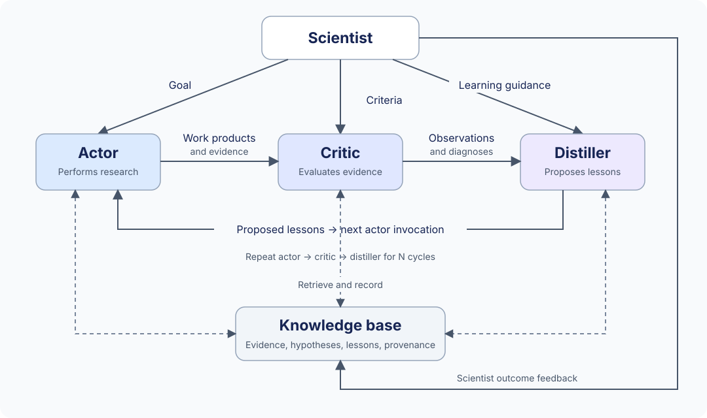
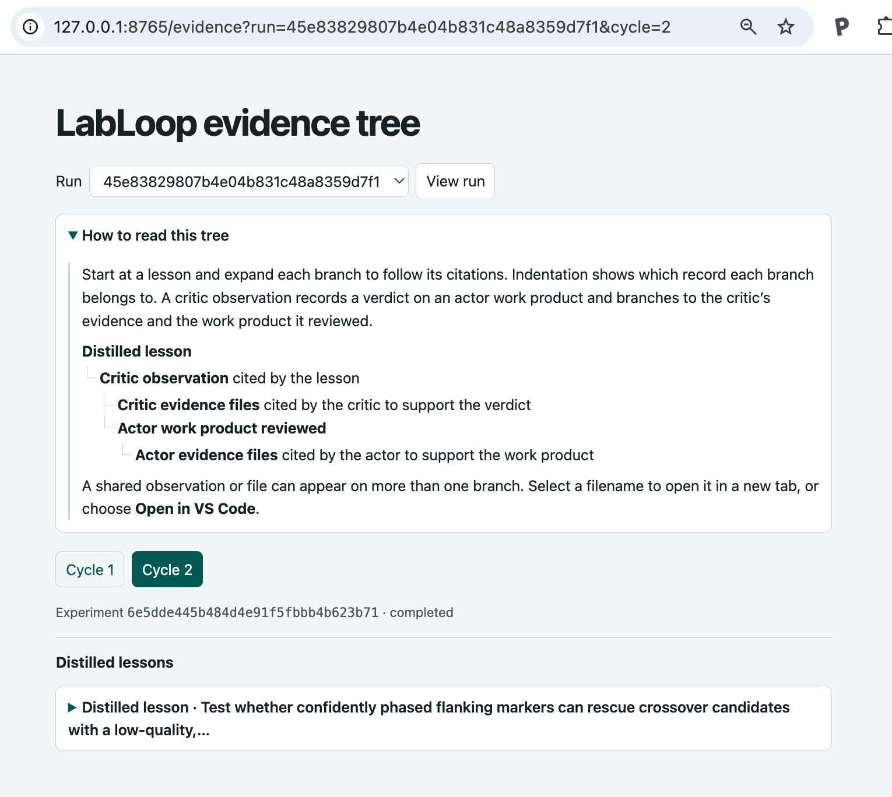
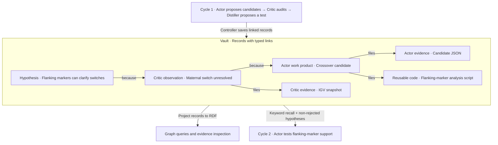

# LabLoop

LabLoop turns what agents learn into reusable code and hypotheses: candidate
facts that later analyses test.
You define a research goal and the criteria for judging the evidence. LabLoop
runs a loop: it performs an analysis, checks the results against your criteria,
and preserves code, evidence, and hypotheses with proposed follow-up tests. The
next round builds on that code and tests the hypotheses in a new analysis.

<a name="case-study-crossover-discovery"></a>

## Case study: meiotic crossover discovery in trios

The [LabLoop presentation](https://docs.google.com/presentation/d/1FzK2NiQOgYmQbHzjBBOBRLEBbnM_KE8p-1YNgua9t1U/edit?usp=sharing)
introduces the ideas behind LabLoop and shows the learning loop in action
through a genomics case study on crossover discovery.
LabLoop audited three candidate meiotic crossovers on chromosome 22 using trio
reads and genotype calls. The critic found evidence for one paternal switch
and left two maternal candidates unresolved. The distiller proposed checking
flanking markers, and the next actor implemented that test in
[a reusable analysis script](runs/45e83829807b4e04b831c48a8359d7f1/trio_flank_linkage.py).
Three child reads corroborated the paternal switch on both sides. The run left
both executable code and a testable hypothesis for later analyses.

- [Explore the completed run on GitHub](examples/crossover-walkthrough/README.md)
- [Run the focused crossover example locally](docs/usage.md#run-the-focused-crossover-example)

## How LabLoop works

A scientific learning loop: **actor → critic → distiller → actor → …**.
A Python controller runs each role in a fresh Codex CLI session. Reusable code
persists as experiment artifacts, linked to evidence and hypotheses in a
compounding knowledge base; LLM weights stay unchanged
([conceptual background](docs/learning-agent.md)).



The scientist supplies three prompts in a JSON file:

| Prompt | Role |
| --- | --- |
| `goal` | Actor: investigate and produce work products, including reusable code, with evidence. |
| `criteria` | Critic: evaluate each submitted work product against the scientist's criteria. |
| `distill` | Distiller: propose hypotheses and suggested tests from the observations. |

The next actor tests the proposed hypotheses.
Code makes analysis methods reusable and the proposed tests executable. The
critic evaluates the resulting evidence against the same criteria throughout
the run.

LabLoop is a prototype. See the [documentation index](docs/README.md) for guides
and design notes.

## Quick start

Requires Python 3.11 or later. Run a demo with synthetic evidence and no model access:

```bash
python3 -m venv .venv
source .venv/bin/activate
python -m pip install -e '.[test]'
python -m labloop.cli run examples/demo.json --demo --cycles 2 --vault runs/demo-vault
python -m pytest -q
```

After the quick-start demo, start the local server from the repository root
with your virtual environment active.

```bash
python -m labloop.cli serve --vault runs/demo-vault --runs runs
```

Open [http://127.0.0.1:8765/](http://127.0.0.1:8765/) and choose a run and cycle.
Expand a distilled hypothesis to see the critic observations it cites. Each
observation branches into the critic's evidence files and the actor work product
it reviewed. Expand the work product to find the actor's evidence files.
Follow these links to inspect the code behind an analysis as well as its results.
Click a filename to preview or download it, or choose **Open in VS Code**.

The viewer looks like this, shown here with Cycle 2 of the crossover run.

<a href="docs/evidence-tree.png">
  
</a>

For other runs, pass the same `--vault` and `--runs` paths you used to run
LabLoop. The defaults are `vault` and `runs`.

## GraphRAG and the evidence graph

LabLoop uses retrieval-augmented generation (RAG) to bring prior findings into
each new analysis. Its knowledge base stores structured Markdown records, links
them to code and other evidence files, and represents their relationships as an
RDF graph.

The diagram follows one of the crossover hypothesis's three observation links
and shows how the hypothesis guides the next analysis.



Each cycle retrieves records matching the research goal and gives the actor
non-rejected hypotheses to test. Agents can search further with
`recall --research-only`, which excludes archived task instructions. Retrieval
ranks records by keyword overlap and recency.
Linked code artifacts let agents inspect and build on earlier analysis methods
while testing the hypotheses those analyses produced.

## Evaluation and validation

LabLoop combines expert criteria, evidence traceability, and scientist oversight:

| Capability | What it does |
| --- | --- |
| Critic evaluation | Reviews each submitted work product against the scientist's fixed `criteria`, returning `supported`, `contradicted`, or `uncertain`, with a diagnosis. Optional IGV views support visual review. |
| Evidence audit trail | Links hypotheses to critic observations, reviewed work products, and cited evidence files for inspection. Run records preserve prompts, results, traces, and file hashes for auditing. |
| Scientist correction | Supplies corrective feedback for later analyses or retires an eligible hypothesis through contradictory feedback. |

Every distilled hypothesis must cite critic observations from the current cycle.
[Pydantic schemas](labloop/report_schemas.py) and the
[Python controller](labloop/loop.py) enforce citation requirements, check that
evidence files exist, reject duplicate products, and require contradictory
observations for agent-proposed retractions.
Citation checks establish traceability, not scientific correctness. Critic
judgments still need expert review and independent validation.

For related background, see Frank Coyle's
[Why Agentic Systems Need Ontologies](https://www.youtube.com/watch?v=Sir59K8ZDPU)
(AI Engineer), which distinguishes type checks from domain-rule validation in
agent loops. LabLoop currently enforces the rules above through Pydantic and
Python; ontology-based validation could extend this approach.

Critic evaluation, evidence traceability, and scientist feedback provide a
foundation for evaluation. Measuring reliability across independent trials,
calibrating critic judgments against expert assessments, and detecting quality
regressions remain future work
([Anthropic's agent-evaluation guide](https://www.anthropic.com/research/demystifying-evals-for-ai-agents)).

## Sharing knowledge across labs

Publishing knowledge bases on the Semantic Web would extend the learning loop
within and across labs. Members of a given lab could build on each other's
reusable code and hypotheses from a shared record of experiments and evidence.
Researchers across a network of labs
could discover those records, adapt linked code, use data from their own labs to
test hypotheses shared by other labs, and share their results. Published knowledge bases could also
speed up peer review by helping reviewers trace claims to their supporting
evidence and see which hypotheses are still open.

Some of these thoughts are not new.
[Paper2Agent](https://arxiv.org/pdf/2509.06917) serves research papers over MCP to AI agents.
[Booeshaghi, Luebbert, and Pachter](https://www.biorxiv.org/content/10.64898/2026.01.30.702911v1.full.pdf) went further when they argued that “machine-readable science should
be generated at the point of publication, not after the fact.” We agree.

The network could be organized like Mastodon. A lab could run its own LabLoop
server, much as a community can run its own Mastodon server. Just as a Mastodon
client connects to a home server and shows posts from other servers, a LabLoop
client could connect to a researcher's lab server and let them explore records
published by other labs.

The proposed Linked Data publication model would give each published hypothesis,
observation, and evidence record a stable HTTPS URL, such as
`https://lab1.labloop.org/id/<record-id>`. The URL would serve a readable page
or an RDF description with links to related records. Using coding agents,
another lab could follow a hypothesis to its supporting code and evidence, reuse or
adapt the analysis, and link its own replication results back to the original
record.

For example, another lab could use LabLoop's RDF vocabulary and a standard tool
such as RDFLib to follow links from hypotheses to observations and evidence files,
without installing LabLoop. Reading the Markdown vault directly would instead
require custom code to parse its YAML metadata and reconstruct those links,
coupling that code to LabLoop's storage conventions.

The RDF vocabulary describes record types and relationships; it does not yet
express all the validation rules in LabLoop's Pydantic models and Python
controller.

To share a live vault with agents on the web, run `labloop serve` behind an
HTTPS reverse proxy. Agents can search the latest records or fetch the current
graph as Turtle or JSON-LD and query it with RDF tools.
[Knowledge-base guide for live web access](docs/knowledge-base.md#live-web-access)

<a name="future-work"></a>

<a name="roadmap"></a>

In addition to the goal of publishing vaults as Linked Data, the [roadmap](docs/roadmap.md) also covers checkpoint commits for
reproducing experiments and authenticated access to shared lab vaults.
