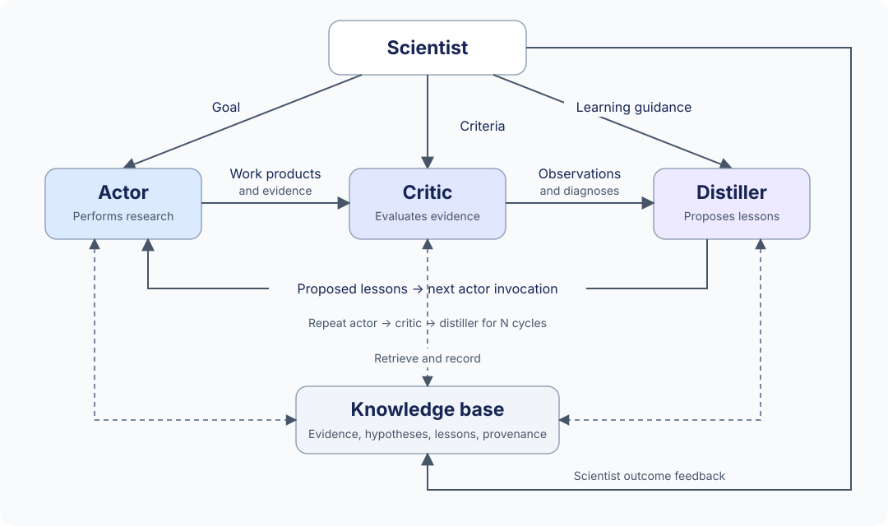
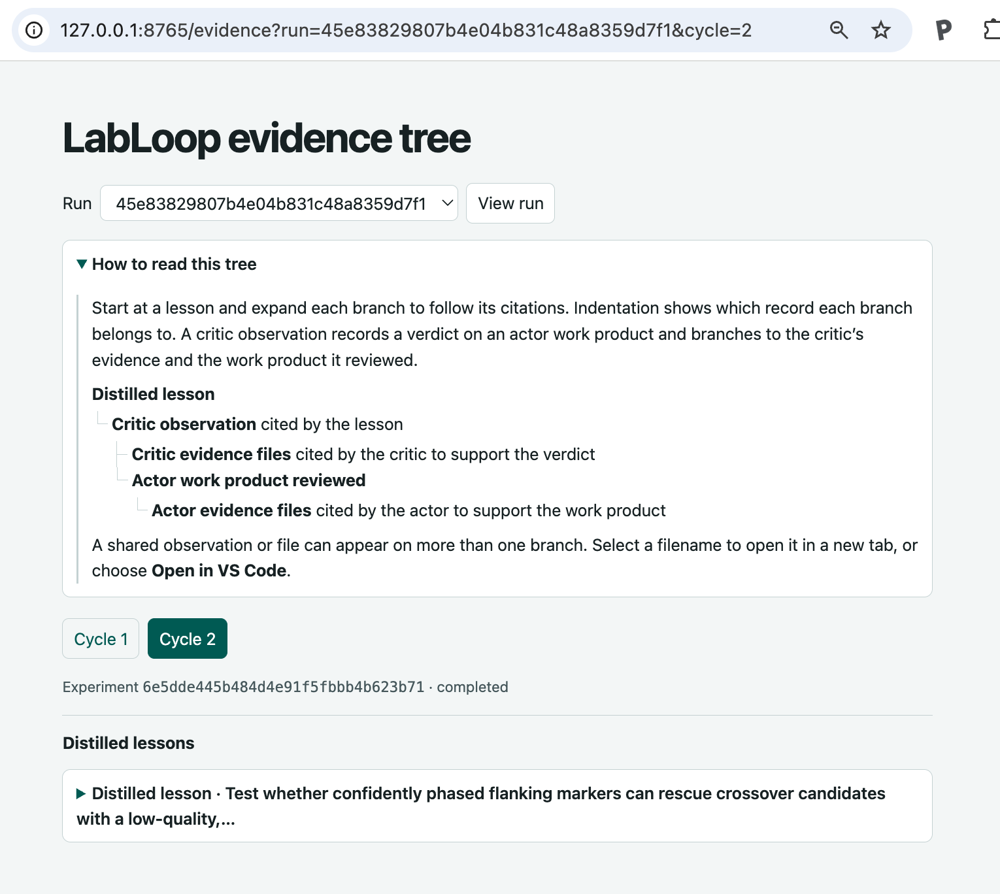

# LabLoop

You define a research goal and the criteria for judging the evidence. LabLoop
runs a loop: it performs an analysis, checks the results against your criteria,
and records a lesson with a proposed follow-up test. The next round uses that
lesson to guide the analysis.

<a name="case-study-crossover-discovery"></a>

## Case study: meiotic crossover discovery in trios

LabLoop audited three candidate meiotic crossovers on chromosome 22 using trio
reads and genotype calls. The critic found evidence for one paternal switch
and left two maternal candidates unresolved. The distiller proposed checking
flanking markers, and the next actor wrote a script to test that lesson.
Three child reads corroborated the paternal switch on both sides.

- [Explore the completed run on GitHub](examples/crossover-walkthrough/README.md)
- [Run the focused crossover example locally](docs/usage.md#run-the-focused-crossover-example)

## How LabLoop works

A scientific learning loop: **actor → critic → distiller → actor → …**.
A Python controller runs each role in a fresh Codex CLI session. Lessons persist
and evolve in a compounding knowledge base; LLM weights stay unchanged
([conceptual background](docs/learning-agent.md)).
The [LabLoop presentation](https://docs.google.com/presentation/d/1FzK2NiQOgYmQbHzjBBOBRLEBbnM_KE8p-1YNgua9t1U/edit?usp=sharing)
introduces the ideas behind LabLoop and shows the learning loop in action
through a genomics case study on crossover discovery.



The scientist supplies three prompts in a JSON file:

| Prompt | Role |
| --- | --- |
| `goal` | Actor: investigate and produce work products with evidence. |
| `criteria` | Critic: audit each product against the scientist's criteria. |
| `distill` | Distiller: propose lessons and suggested tests from the observations. |

Lessons remain hypotheses for the next actor to test. The critic evaluates the
resulting evidence against the same criteria throughout the run.

LabLoop is a prototype. See the [documentation index](docs/README.md) for guides
and design notes.

## Quick start

Requires Python 3.11 or later. Run a demo with synthetic evidence and no model access:

```bash
python3 -m venv .venv
source .venv/bin/activate
python -m pip install -e '.[test]'
python -m labloop.cli run examples/demo.json --demo --cycles 2 --vault runs/demo-vault
python -m pytest -q
```

After the quick-start demo, start the local server from the repository root
with your virtual environment active.

```bash
python -m labloop.cli serve --vault runs/demo-vault --runs runs
```

Open [http://127.0.0.1:8765/](http://127.0.0.1:8765/) and choose a run and cycle.
Expand a distilled lesson to see the critic observations it cites. Each
observation branches into the critic's evidence files and the actor work product
it reviewed. Expand the work product to find the actor's evidence files.
Click a filename to preview or download it, or choose **Open in VS Code**.

For other runs, pass the same `--vault` and `--runs` paths you used to run
LabLoop. The defaults are `vault` and `runs`.

<a href="docs/evidence-tree.png">
  
</a>

## Sharing knowledge across labs

Publishing knowledge bases on the Semantic Web extends the learning loop
within and across labs, which is the idea behind the name **LabLoop**. Lab
members can build on each other's work from a shared record of experiments,
evidence, and open hypotheses. Researchers in other labs can discover those
records, test hypotheses on their own data, and share what they find. Published
knowledge bases can also speed up peer review by helping reviewers trace
claims to their supporting evidence and see which hypotheses are still open (compare
[Paper2Agent](https://arxiv.org/pdf/2509.06917)).

> The clear implication is that machine-readable science should be generated at
> the point of publication, not after the fact.

Booeshaghi, Luebbert, and Pachter (2026). [*Science should be machine-readable*](https://www.biorxiv.org/content/10.64898/2026.01.30.702911v1.full.pdf)

LabLoop represents its knowledge base as RDF using Semantic Web standards.
To share a live vault with agents on the web, run `labloop serve` behind an
HTTPS reverse proxy. Agents can search the latest records or fetch the current
graph as Turtle or JSON-LD and query it with RDF tools.
[Knowledge-base guide for live web access](docs/knowledge-base.md#live-web-access)

The planned Linked Data publication model would give each published lesson,
observation, and evidence record a stable HTTPS URL, such as
`https://lab1.labloop.org/id/<record-id>`. The URL would serve a readable page
or an RDF description with links to related records. Another lab could follow
a lesson to its supporting evidence and link its own replication results back
to the original record.

<a name="future-work"></a>

<a name="roadmap"></a>

The [full roadmap](docs/roadmap.md) also covers checkpoint commits for
reproducing experiments and authenticated access to shared lab vaults.
