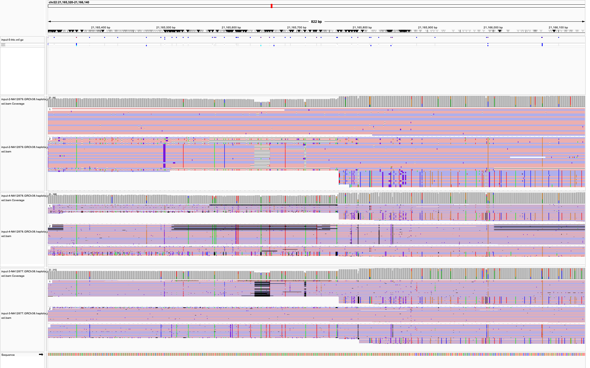

# How a crossover audit became a follow-up test

LabLoop reviewed three candidate crossovers on chromosome 22. The first critic
found evidence for one paternal crossover and left two maternal candidates
unresolved. Its observations led to a proposed analysis rule that the next actor
implemented and tested on the same three candidates.

## Cycle 1 · Audit the candidates

The actor received three candidate intervals and used the trio's sequencing reads
and genotype calls to build a case for each one. The scientist asked the critic
to check whether the child's reads supported a switch between the two copies of
the same parent's chromosome. Unresolved calls were to stay uncertain.

At chr22:21,165,471–21,165,499, the genotype calls suggested a maternal switch.
One endpoint had a low-confidence maternal genotype, and reads from both parents
also carried the child's four-marker pattern. The critic requested a zoomed,
phase-grouped view to inspect the local alignments. LabLoop rendered it in IGV
and returned it to the critic, which recorded the call as uncertain.
[Critic observations](vault-excerpts.md#cycle-1-critic-observations)

The maternal track shows mismatches and alignment gaps. The critic combined
that visual context with the read and genotype evidence in its audit.

## Between cycles · Store a testable lesson

The supported paternal candidate had child reads linking the endpoint pattern
to informative markers outside the interval. The distiller proposed searching
for such markers on both sides and using that read linkage to prioritize
candidates for review. It also proposed testing the ranking on independently
adjudicated candidates. LabLoop saved the lesson as a `proposed` heuristic with
links to the three observations that motivated it.
[Distilled lesson and proposed test](vault-excerpts.md#distilled-lesson)

## Cycle 2 · Apply the lesson and audit again

The next actor used a fixed 15 kb window on either side of each interval. It
required a trio genotype quality score of at least 20 and checked whether
parental reads supported each marker's phase. The critic then audited the three
candidates again under the same review criteria.

| Candidate on chr22 | First audit | Follow-up |
| --- | --- | --- |
| 20,959,352–20,961,970 (paternal) | Supported | Three child reads linked the endpoint pattern to corroborating markers on both sides. The critic reproduced the read audit and retained its supported verdict. |
| 21,165,471–21,165,499 (maternal) | Uncertain | One downstream marker qualified. The switch remained unresolved. |
| 21,291,740–21,291,798 (maternal) | Uncertain | No flanking markers qualified. The switch remained unresolved. |

All three candidates stayed in the review set, and the review order stayed the
same. The follow-up automated the marker search on previously reviewed cases.
Measuring detection accuracy would require independently adjudicated cases.
[Second-cycle critic observation](vault-excerpts.md#cycle-2-critic-observation) ·
[Actor's comparison output](trio-flank-comparison.json)

## Try the loop on your own task

This workflow fits analyses where you can specify what counts as credible
evidence, review individual outputs, and rerun the analysis to test a proposed
change. The vault preserves the observations and the proposed test so the next
actor can use them. Start with the [synthetic demo](../../README.md#quick-start),
then adapt the `goal`, `criteria`, and `distill` prompts in the
[example configuration](../demo.json).
